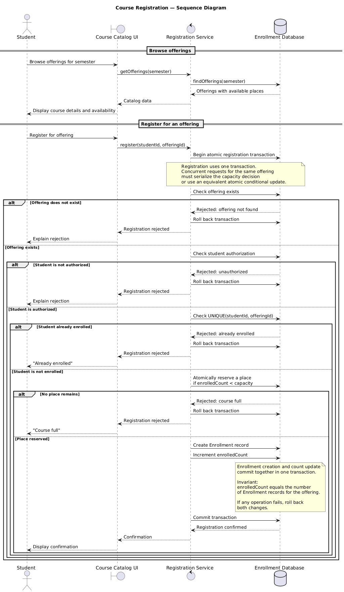
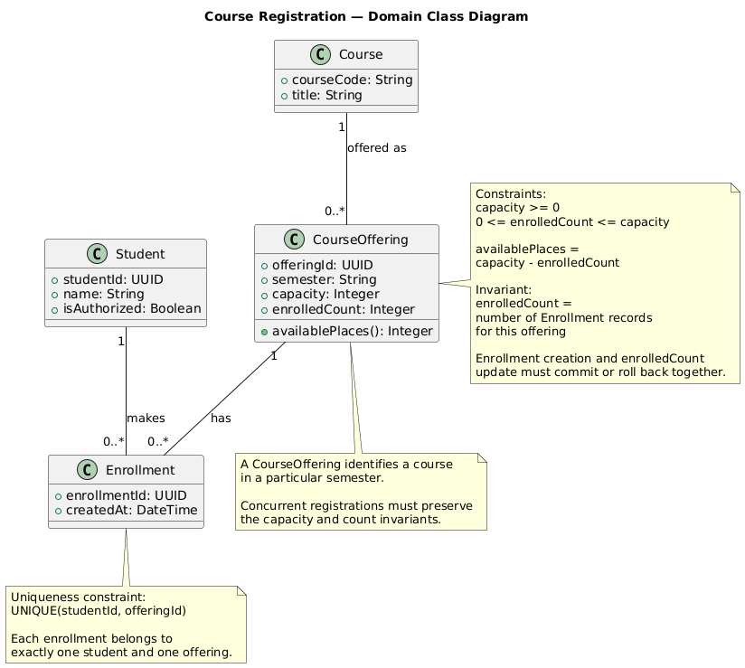
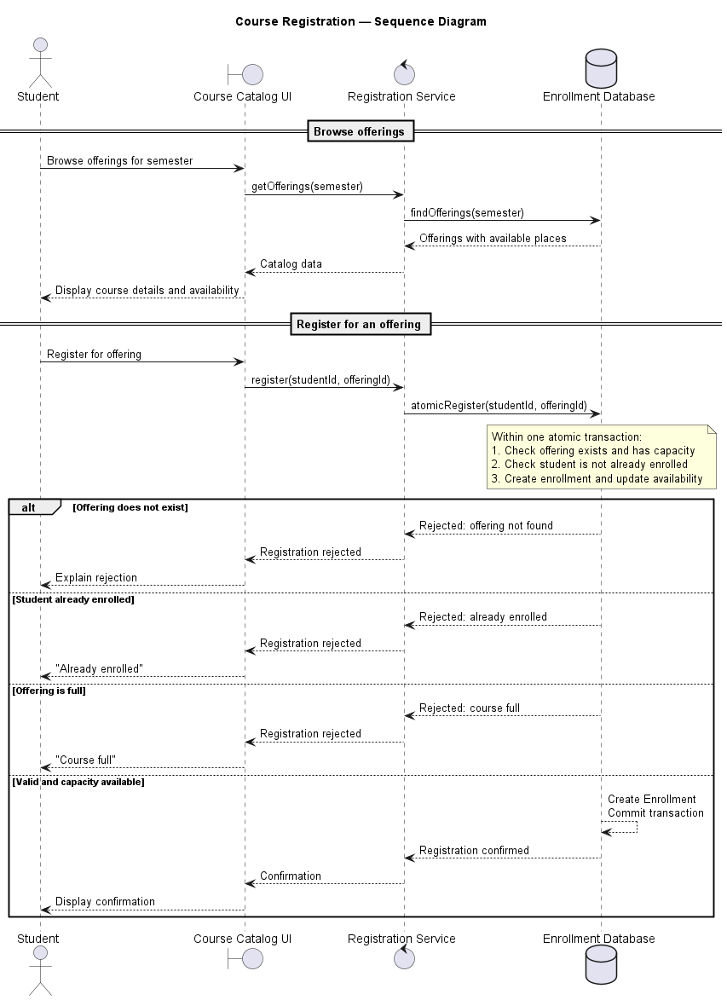

# SIS #02 — AI-Assisted UML Modeling: University Course Registration

## 1. Scope and assumptions

**Scope:** The system allows students to browse course offerings for one semester, view course details and available places, and register for an offering. It records successful enrollments, updates availability, provides confirmation, and clearly explains rejected registration attempts. Payments, prerequisites, timetable clashes, waiting lists, and cancellation are out of scope.

**Assumptions:**

1. Students must be authorized to register, and each enrollment links one student to one course offering.
2. Each offering has a defined capacity. The system must prevent duplicate enrollments for the same student and offering and must not allow the enrollment count to exceed capacity, including during concurrent registration attempts.
## 2. User stories and acceptance criteria

### US-01 — Browse offerings

**US-01:** As a student, I want to view course offerings for one semester, so that I can check course details and available places.

- **AC-01** (R1): Given a semester with course offerings, When a student views the catalog for that semester, Then the system displays each offering's course code, title, offering identifier, and available places.
- **AC-02** (R1): Given a semester with no course offerings, When a student views the catalog for that semester, Then the system displays an empty catalog.
### US-02 — Register for an offering

**US-02:** As an authorized student, I want to register for an available course offering, so that my enrollment is recorded and I receive confirmation.

- **AC-03** (R2, R3, R4): Given an authorized student who is not enrolled in an offering with available capacity, When the student registers for that offering and a place remains available, Then the system creates exactly one Enrollment linking the student and offering, updates availability, and returns a confirmation.
- **AC-04** (R2, R4, R5): Given an offering with exactly one available place and two different authorized students who are not enrolled in it, When both students attempt to register concurrently, Then at most one new enrollment is created, the enrollment count never exceeds capacity, and any rejected request receives the explanation "course full" without creating an enrollment.
### US-03 — Receive a clear rejection

**US-03:** As a student, I want to receive a clear explanation when registration is rejected, so that I understand why I could not enroll.

- **AC-05** (R2, R5): Given an offering whose capacity has been reached, When an authorized student attempts to register, Then the system rejects the request with the explanation "course full", creates no enrollment, and leaves the enrollment count unchanged.
- **AC-06** (R3, R5): Given an authorized student who is already enrolled in an offering, When the student submits another registration request for the same offering, Then the system rejects the request with the explanation "already enrolled", creates no enrollment, and leaves the enrollment count unchanged.
## 3. Sequence diagram



**Participants:** Student represents the person requesting registration. Course Catalog UI displays offerings and registration results. Registration Service processes requests and checks registration rules. Enrollment Database stores offerings and enrollment records and performs the atomic registration transaction.

**Atomic operation:** The final duplicate check, capacity check, Enrollment creation, and enrolledCount update must be protected by one transaction. The capacity check must be concurrency-safe so that two students cannot claim the last place. If any operation fails, the transaction rolls back. Viewing the catalog only displays current availability and reserves no place.

**Where the Enrollment is created:** The Registration Service sends the `Create Enrollment record` message to the Enrollment Database lifeline. The database creates a record of the `Enrollment` class from section 4. The record and the enrolledCount update are committed together.

**Technical lifelines:** Course Catalog UI, Registration Service, and Enrollment Database are technical lifelines rather than domain classes in the class diagram. This difference is acceptable because the sequence diagram shows interactions between system components, while the class diagram focuses on domain concepts and their relationships.

## 4. Class diagram



| Association | Read left to right | Read right to left |
| --- | --- | --- |
| Course — CourseOffering | One Course can have zero or more CourseOfferings. | Each CourseOffering represents exactly one Course. |
| CourseOffering — Enrollment | One CourseOffering has zero or more Enrollments. | Each Enrollment belongs to exactly one CourseOffering. |
| Student — Enrollment | One Student makes zero or more Enrollments. | Each Enrollment belongs to exactly one Student. |

**How an Enrollment links a student to an offering:** Each Enrollment has an association with exactly one Student and exactly one CourseOffering. It represents a student's registration for a particular course offering.

**Capacity constraint:** `0 <= enrolledCount <= capacity`, and `availablePlaces = capacity - enrolledCount`. Additionally, `enrolledCount` must equal the actual number of Enrollment records for the CourseOffering. Multiplicity alone cannot express this constraint because it does not limit the total number of enrollments according to a CourseOffering's capacity or enforce equality with a stored count.

**Uniqueness constraint:** `UNIQUE(studentId, offeringId)` ensures that the same Student cannot have more than one Enrollment for the same CourseOffering. Multiplicity alone cannot express this pairwise uniqueness rule because it allows multiple Enrollment records for a Student and multiple records for a CourseOffering.

## 5. Traceability

| Rule and criterion | Model evidence | Validation case |
| --- | --- | --- |
| R1 + AC-01, AC-02 | Catalog sequence, `CourseOffering.semester` attribute and the Course–CourseOffering association. | Verify offering details are displayed; verify an empty semester produces an empty catalog. |
| R2 + AC-03, AC-04, AC-05 | Capacity invariant, availablePlaces calculation, atomic capacity check, and transaction. | Register with an available place; submit concurrent requests for the last place; verify a full offering rejects registration. |
| R3 + AC-03, AC-06 | Student–Enrollment association and `UNIQUE(studentId, offeringId)`. | Register an eligible student, then retry with the same student and offering. |
| R4 + AC-03, AC-04 | Enrollment creation and enrolledCount update commit together; capacity remains within bounds. | Verify successful registration updates both values; concurrent last-place requests create at most one new Enrollment. |
| R5 + AC-04, AC-05, AC-06 | Rejection branches for `course full` and `already enrolled`; rollback on rejection. | Verify full and duplicate requests create no Enrollment and leave enrolledCount unchanged. |

## 6. Walkthroughs

| Case | Observed path and state change | Judgment and evidence |
| --- | --- | --- |
| T1. Available | An authorized student who is not enrolled requests registration. The capacity and duplicate checks pass; an Enrollment is created, enrolledCount increases by one, and the transaction commits. | **Pass.** Exactly one Enrollment is created, availability decreases by one, and confirmation is returned. |
| T2. Last place | Two different authorized students concurrently request the final available place. The capacity decision is serialized or handled by an atomic conditional update. One request succeeds; the other is rejected after the place is taken. | **Pass if concurrency protection is implemented.** At most one Enrollment is created, capacity is not exceeded, and the rejected request receives `course full`. |
| T3. Full | An authorized student requests registration when enrolledCount equals capacity. The capacity check fails and the transaction is rolled back. | **Pass.** The request receives `course full`, no Enrollment is created, and enrolledCount remains unchanged. |
| T4. Duplicate | An authorized student who already has an Enrollment requests registration for the same CourseOffering. The uniqueness check rejects the request and the transaction is rolled back. | **Pass.** The request receives `already enrolled`, no additional Enrollment is created, and enrolledCount remains unchanged. |

## 7. Review decisions

| AI suggestion or model element | Decision | Reason | Rule |
| --- | --- | --- | --- |
| Make enrollment creation and availability update explicit in one transaction | Accepted | Keeps enrollment records and available places consistent if any step fails. | R2, R4, R5 |
| Add concurrent registration handling for the last available place | Accepted | Prevents two students from taking the same final place. | R2, R4, R5 |
| Add an invariant connecting enrolledCount to actual enrollment records | Accepted | Prevents incorrect availability caused by stored counts drifting from enrollment records. | R2, R4 |

## 8. Modeling explanation

The sequence diagram shows how a student browses course offerings and registers for an offering. The Course Catalog UI sends requests to the Registration Service, which interacts with the Enrollment Database. Browsing the catalog only displays availability and does not reserve a place. During registration, the system checks authorization, duplicate enrollment, and available capacity. Enrollment creation and the update of `enrolledCount` must happen in one atomic transaction. Concurrent requests for the last place must be handled safely so that the enrollment count never exceeds capacity. If registration is rejected, no new Enrollment is created and the count remains unchanged.

The class diagram represents the main domain concepts: Student, Course, CourseOffering, and Enrollment. A CourseOffering represents a course in a particular semester, stored in its `semester` attribute. Enrollment connects exactly one Student to exactly one CourseOffering. The capacity constraint ensures that `enrolledCount` remains between zero and capacity, while the invariant requires it to equal the actual number of Enrollment records. The uniqueness constraint `UNIQUE(studentId, offeringId)` prevents duplicate registrations. These constraints are necessary because association multiplicities alone cannot express capacity limits, count consistency, or uniqueness for a specific student-offering pair.

The two diagrams describe different aspects of the same system. The sequence diagram explains the order of interactions and the registration process, while the class diagram defines the domain structure and relationships. Together, they support the approved requirements for browsing, successful registration, duplicate rejection, full-course rejection, and concurrent registration.

## 9. Reflection

Reviewing the UML models helped me understand that a diagram must represent not only the normal registration process but also situations where several requests happen at the same time. My initial model described an atomic registration operation, but the review showed that this was not detailed enough. I needed to make enrollment creation and the availability update explicit within the same transaction and explain how concurrent requests for the last place are handled.

I also learned that storing `enrolledCount` creates a consistency responsibility. The value must match the actual Enrollment records, or the system may display incorrect availability. Similarly, association multiplicities do not replace explicit capacity and uniqueness constraints.

I accepted these changes because they improve the consistency of the model without changing its approved scope. However, the UML diagrams do not prove that the implementation is safe. The database must use an appropriate concurrency-control mechanism, enforce uniqueness, and preserve the count invariant. Testing successful registration, full offerings, duplicate requests, and simultaneous attempts is necessary to validate the behavior. This review helped me distinguish between describing a requirement in a model and implementing and testing it correctly.


## 10. Appendix A — Before AI

<!-- Written BEFORE you run Prompt A, committed and pushed in your first commit, and never
     edited afterwards. This is what you paste into Prompt A as "My initial assumptions". -->

**Scope:** Student takes it from the requirements: browses the catalog, selects an offering, and requests registration. 
After that student recall R2-R5: checks availability and for duplicates, creates a record, and returns a confirmation or the reason for rejection.
Five points from the problem are: payments, prerequisites, timetable clashes, waiting lists, cancellation.
**Initial assumptions:**

1. Available places equal the offering's capacity minus its current number of enrollments.
2. If two students request the last place at the same time, only the first processed request succeeds.

## 11. Appendix B — AI exchanges

<!-- Complete prompts and complete responses, as text — never screenshots. Paste each inside
     the ~~~~ block that follows its label: AI responses contain ``` PlantUML blocks, and
     ~~~~ keeps them from breaking this file. Prompts B and C: the prompt text first, then
     the material it refers to ("below", "these two") pasted under it, in the same block.
     You may add B5, B6 … after B4 if you ran more. -->

### B1 — Requirements (Prompt A)

- **Tool:** Claude.ai
- **Model:** Claude Sonnet 5.5
- **Date:** 2026-10-12
- **Purpose:** draft 3 user stories and 6 acceptance criteria

<!-- Model: the exact model with its version, as the tool shows it (e.g. "GPT-5 Thinking",
     "Claude Sonnet 4.5"). If the tool does not show it, write: not displayed
     Date: YYYY-MM-DD -->

**Prompt:**

~~~~text
Act as a requirements analyst. Use only this course registration scenario and rules R1–R5: A student browses an electronic course catalog, chooses a course offering and requests registration. Each offering has a limited number of places. A Course describes a subject. A CourseOffering is one scheduled section in one semester. Registration always targets a specific offering. Assume that the student is signed in, the selected offering exists, and its capacity is a positive whole number. Exclude payments, prerequisites, timetable clashes, waiting lists and cancellation. Use fictional students and courses. R1. Catalog: Show the course code, title, offering and available places for one semester. R2. Capacity: Recheck current availability when registering. Enrollment must never exceed the offering's capacity. R3. Duplicates: A student may have at most one enrollment in the same offering. Reject a repeat request. R4. Success: Create exactly one Enrollment linking the student and offering, update availability and return a confirmation. R5. Rejection: Explain "course full" or "already enrolled". Create no enrollment and leave the enrollment count unchanged. A catalog view does not reserve a place. Model the final checks and enrollment creation as one atomic operation so competing requests cannot take the same last place. My initial assumptions are 1. Available places equal the offering's capacity minus its current number of enrollments. 2. If two students request the last place at the same time, only the first processed request succeeds.
Draft 3 user stories and 2 Given / When / Then acceptance criteria for each. Use IDs US-01 to US-03 and AC-01 to AC-06. Map each criterion to rule IDs.
Cover normal and rejection behavior. List uncertainty separately. Do not add excluded features or invent university policies.
~~~~

**Response:**

~~~~text
## User stories and acceptance criteria

### US-01 — Browse offerings

**US-01:** As a student, I want to browse the catalog of course offerings for one semester and see each course code, title, offering and available places, so that I can choose an offering that still has room.

- **AC-01** (R1): Given a semester that has course offerings, When the student opens the catalog, Then each listed offering shows its course code, course title, offering and available places, where available places equal capacity minus current enrollments.
- **AC-02** (R1, R2): Given the catalog shows an offering with available places, When the student selects that offering, Then no place is reserved and the displayed number of places is informational only.

### US-02 — Register for an offering

**US-02:** As a student, I want to request registration for a specific offering, so that I receive a confirmed place in it.

- **AC-03** (R2, R3, R4): Given an offering with at least one available place and a student with no enrollment in it, When the student requests registration, Then the system rechecks current availability and existing enrollment, creates exactly one Enrollment linking the student and the offering, reduces available places by one and returns a confirmation.
- **AC-04** (R2, R4): Given an offering with capacity 2 and 1 current enrollment, When a different student requests registration, Then the registration is accepted, the enrollment count becomes 2, no places remain and the number of enrollments never exceeds capacity.

### US-03 — Receive a clear rejection

**US-03:** As a student, I want a clear reason when my registration cannot be completed, so that I understand why and nothing changes without my knowledge.

- **AC-05** (R2, R5): Given the catalog showed an available place but the current enrollment count equals the capacity, When the student requests registration, Then the system rejects the request with the reason "course full", creates no Enrollment and leaves the enrollment count unchanged.
- **AC-06** (R3, R5): Given a student who already has an enrollment in an offering, When the same student requests that offering again, Then the system rejects the request with the reason "already enrolled", creates no Enrollment and leaves the enrollment count unchanged.

## Rule coverage

- R1: AC-01, AC-02
- R2: AC-02, AC-03, AC-04, AC-05
- R3: AC-03, AC-06
- R4: AC-03, AC-04
- R5: AC-05, AC-06

Normal behavior is covered by AC-01 to AC-04; rejection behavior by AC-05 and AC-06.

## Uncertainty (not resolved in the criteria above)

1. If a student is already enrolled and the offering is also full, the rules do not say which reason ("already enrolled" or "course full") should be returned first. The criteria above avoid this combined case.
2. The rules do not say whether the catalog shows offerings that already have zero available places, so AC-01 does not state it.
3. The content and format of the confirmation are not specified; the criteria only require that a confirmation is returned.
4. Assumption 2 says the "first processed request" succeeds, but how the processing order is determined is not defined by the scenario.
5. The scenario does not say whether the student chooses the semester or whether one semester is fixed for the catalog; the criteria assume one semester is shown.
6. AC-02 describes the absence of a reservation, which is hard to observe directly; it is testable only through the later outcome of a registration request (see AC-05).
~~~~

### B2 — UML drafts (Prompt B)

- **Tool:** ChatGPT
- **Model:** GPT-6
- **Date:** 2026-10-17
- **Purpose:** draft the sequence and class diagrams  
**Prompt:**
```
Using my approved scenario, R1–R5, stories and criteria below, return separate PlantUML code blocks for a sequence diagram and a domain class diagram.
Sequence: include catalog browsing and guarded success, full-course and duplicate outcomes. Model final checks and creation as one atomic operation.
Class: show domain concepts, useful attributes and multiplicities. State the capacity and uniqueness constraints. Explain assumptions and any technical lifelines.
Approved requirements:
### US-01 — Browse offerings

**US-01:** As a student, I want to view course offerings for one semester, so that I can check course details and available places.

- **AC-01** (R1): Given a semester with course offerings, When a student views the catalog for that semester, Then the system displays each offering's course code, title, offering identifier, and available places.
- **AC-02** (R1): Given a semester with no course offerings, When a student views the catalog for that semester, Then the system displays an empty catalog.
### US-02 — Register for an offering

**US-02:** As an authorized student, I want to register for an available course offering, so that my enrollment is recorded and I receive confirmation.

- **AC-03** (R2, R3, R4): Given an authorized student who is not enrolled in an offering with available capacity, When the student registers for that offering and a place remains available, Then the system creates exactly one Enrollment linking the student and offering, updates availability, and returns a confirmation.
- **AC-04** (R2, R4, R5): Given an offering with exactly one available place and two different authorized students who are not enrolled in it, When both students attempt to register concurrently, Then at most one new enrollment is created, the enrollment count never exceeds capacity, and any rejected request receives the explanation "course full" without creating an enrollment.
### US-03 — Receive a clear rejection

**US-03:** As a student, I want to receive a clear explanation when registration is rejected, so that I understand why I could not enroll.

- **AC-05** (R2, R5): Given an offering whose capacity has been reached, When an authorized student attempts to register, Then the system rejects the request with the explanation "course full", creates no enrollment, and leaves the enrollment count unchanged.
- **AC-06** (R3, R5): Given an authorized student who is already enrolled in an offering, When the student submits another registration request for the same offering, Then the system rejects the request with the explanation "already enrolled", creates no enrollment, and leaves the enrollment count unchanged.
```

**Response:**

```
Below are two PlantUML diagrams based on your approved course-registration scenario. They include catalog browsing, successful registration, full-course rejection, duplicate-enrollment rejection, and protection against concurrent registration exceeding capacity.1. Sequence diagramThis diagram models the final validation and enrollment creation as one atomic operation so two concurrent requests cannot take the same last place.
@startuml
title Course Registration — Sequence Diagram

actor Student
boundary "Course Catalog UI" as UI
control "Registration Service" as RS
database "Enrollment Database" as DB

== Browse offerings ==

Student -> UI: Browse offerings for semester
UI -> RS: getOfferings(semester)
RS -> DB: findOfferings(semester)
DB --> RS: Offerings with available places
RS --> UI: Catalog data
UI --> Student: Display course details and availability

== Register for an offering ==

Student -> UI: Register for offering
UI -> RS: register(studentId, offeringId)
RS -> DB: atomicRegister(studentId, offeringId)

note over DB
Within one atomic transaction:
1. Check offering exists and has capacity
2. Check student is not already enrolled
3. Create enrollment and update availability
end note

alt Offering does not exist
    DB --> RS: Rejected: offering not found
    RS --> UI: Registration rejected
    UI --> Student: Explain rejection
else Student already enrolled
    DB --> RS: Rejected: already enrolled
    RS --> UI: Registration rejected
    UI --> Student: "Already enrolled"
else Offering is full
    DB --> RS: Rejected: course full
    RS --> UI: Registration rejected
    UI --> Student: "Course full"
else Valid and capacity available
    DB --> DB: Create Enrollment\nCommit transaction
    DB --> RS: Registration confirmed
    RS --> UI: Confirmation
    UI --> Student: Display confirmation
end

@enduml
How it worksBrowsing retrieves offerings and their available places.A registration request checks for an existing enrollment and available capacity.The database performs the checks and enrollment creation atomically. If two students request the last place concurrently, at most one registration succeeds.A rejected request creates no enrollment and returns a clear explanation.The “offering not found” outcome is a defensive assumption. The three main registration outcomes required by your criteria are duplicate enrollment, full course, and success.2. Domain class diagram
@startuml
title Course Registration — Domain Class Diagram

class Student {
  +studentId: UUID
  +name: String
  +isAuthorized: Boolean
}

class Semester {
  +semesterId: UUID
  +name: String
}

class Course {
  +courseCode: String
  +title: String
}

class Offering {
  +offeringId: UUID
  +capacity: Integer
  +enrolledCount: Integer
  +availablePlaces(): Integer
}

class Enrollment {
  +enrollmentId: UUID
  +createdAt: DateTime
}

Semester "1" -- "0..*" Offering : contains
Course "1" -- "0..*" Offering : offered as
Offering "1" -- "0..*" Enrollment : has
Student "1" -- "0..*" Enrollment : makes

note right of Offering
Constraint:
capacity >= 0
0 <= enrolledCount <= capacity

availablePlaces =
capacity - enrolledCount
end note

note bottom of Enrollment
Uniqueness constraint:
UNIQUE(studentId, offeringId)

Each enrollment belongs to
exactly one student and one offering.
end note

note bottom of Offering
An offering identifies a course
in a particular semester.

Enrollment changes must preserve
the capacity constraint.
end note

@enduml
3. Assumptions and technical lifelinesElementPurposeStudentRepresents an authorized student who browses and registers.CourseStores the course code and title.SemesterGroups offerings by semester.OfferingRepresents a particular course offering with a defined capacity.EnrollmentRecords the relationship between a student and an offering.Course Catalog UITechnical lifeline that displays catalog data and registration results.Registration ServiceTechnical lifeline that receives requests and coordinates registration.Enrollment DatabaseTechnical lifeline responsible for atomic registration and persistent constraints.Key constraintsCapacity: The number of enrollments must never exceed the offering's capacity.Uniqueness: A student can have at most one enrollment for the same offering.Atomicity: Validation and enrollment creation must behave as one indivisible operation under concurrent requests.Rejection: A rejected registration does not create an enrollment and returns a clear reason.Availability: Available places equal capacity minus the number of enrolled students.Important implementation detail: The class diagram expresses domain constraints, while the sequence diagram shows how registration is performed. In a real database, enforce uniqueness with a unique constraint on (studentId, offeringId). Capacity needs an appropriate transaction or locking strategy; checking availability in application code alone is not sufficient to prevent concurrent overbooking.
```

### B3 — Model critique (Prompt C)

- **Tool:** ChatGPT
- **Model:** GPT-6
- **Date:** 2026-10-17
- **Purpose:** review both models against R1–R5 and T1–T4  
**Prompt:**
```
Review these two UML models against R1–R5 and my acceptance criteria. Check message order, guards, state changes, multiplicities and naming.
Inspect the four validation cases: available places, exactly one place, full course after a stale catalog view, and duplicate registration.
For each issue, cite the affected rule and model element. Explain the impact and propose a focused correction. Separate genuine defects from optional design choices.
#sequence.puml@startumltitle Course Registration — Sequence Diagramactor Studentboundary "Course Catalog UI" as UIcontrol "Registration Service" as RSdatabase "Enrollment Database" as DB== Browse offerings ==Student -> UI: Browse offerings for semesterUI -> RS: getOfferings(semester)RS -> DB: findOfferings(semester)DB --> RS: Offerings with available placesRS --> UI: Catalog dataUI --> Student: Display course details and availability== Register for an offering ==Student -> UI: Register for offeringUI -> RS: register(studentId, offeringId)RS -> DB: atomicRegister(studentId, offeringId)note over DBWithin one atomic transaction:1. Check offering exists and has capacity2. Check student is not already enrolled3. Create enrollment and update availabilityend notealt Offering does not exist    DB --> RS: Rejected: offering not found    RS --> UI: Registration rejected    UI --> Student: Explain rejectionelse Student already enrolled    DB --> RS: Rejected: already enrolled    RS --> UI: Registration rejected    UI --> Student: "Already enrolled"else Offering is full    DB --> RS: Rejected: course full    RS --> UI: Registration rejected    UI --> Student: "Course full"else Valid and capacity available    DB --> DB: Create Enrollment\nCommit transaction    DB --> RS: Registration confirmed    RS --> UI: Confirmation    UI --> Student: Display confirmationend@enduml\#classes.puml@startumltitle Course Registration — Domain Class Diagramclass Student {  +studentId: UUID  +name: String  +isAuthorized: Boolean}class Semester {  +semesterId: UUID  +name: String}class Course {  +courseCode: String  +title: String}class Offering {  +offeringId: UUID  +capacity: Integer  +enrolledCount: Integer  +availablePlaces(): Integer}class Enrollment {  +enrollmentId: UUID  +createdAt: DateTime}Semester "1" -- "0..*" Offering : containsCourse "1" -- "0..*" Offering : offered asOffering "1" -- "0..*" Enrollment : hasStudent "1" -- "0..*" Enrollment : makesnote right of OfferingConstraint:capacity >= 00 <= enrolledCount <= capacityavailablePlaces =capacity - enrolledCountend notenote bottom of EnrollmentUniqueness constraint:UNIQUE(studentId, offeringId)Each enrollment belongs toexactly one student and one offering.end notenote bottom of OfferingAn offering identifies a coursein a particular semester.Enrollment changes must preservethe capacity constraint.end note@enduml\
```

**Response:**

```
UML model review: Course RegistrationThe models are a good starting point: the sequence diagram includes browsing, registration outcomes, and an atomic registration operation, while the class diagram represents students, courses, semester offerings, and enrollments.The main risks are whether the atomic operation is actually enforced, whether the sequence covers all required validation cases, and whether the class constraints prevent overbooking and duplicate registrations.I will use the approved rules:R1: Browse the semester catalog showing course code, title, offering, and available places.R2: Recheck capacity during registration; never exceed it.R3: Reject duplicate registrations.R4: On success, create exactly one Enrollment, update availability, and confirm registration.R5: For a full course or duplicate, return the correct rejection, create no enrollment, and leave the enrollment count unchanged.Acceptance criteria include catalog results, successful registration, concurrent attempts for the last place, full-course rejection, and duplicate-registration rejection.1. Sequence diagram reviewFindings and correctionsDefectS1 — Availability is not explicitly updatedAffected rules: R2, R4, R5 · Element: DB --> DB: Create EnrollmentThe success branch creates an enrollment and commits the transaction, but it does not explicitly show enrolledCount increasing or available places decreasing. The transaction note mentions updating availability, but the actual success message does not show that state change.Impact: The diagram does not clearly demonstrate that a successful registration consumes one place, or that the count remains consistent with enrollments.Correction: Show both enrollment creation and count update inside the same transaction. For example: Create Enrollment; increment enrolledCount; commit. Ensure the change is atomic.DefectS2 — Last-place concurrency is not demonstratedAffected rules: R2, R4, R5 · Element: RS -> DB: atomicRegister(studentId, offeringId)The single registration request and the alt block show possible outcomes, but not two students attempting to claim the final place concurrently.Impact: The model does not explicitly demonstrate AC-04: at most one request can succeed when only one place remains.Correction: Add a separate par fragment or a note describing two simultaneous requests. Both must use the same atomic capacity check and update. One request succeeds; the other is rejected as full. A database transaction must use appropriate locking, conditional updates, or equivalent concurrency control.Needs clarificationS3 — Validation order is inconsistentAffected rules: R2, R3, R5 · Elements: transaction note and alt branchesThe transaction note checks capacity before checking for a duplicate, but the alt block presents duplicate registration before the full-course outcome.Impact: If a student is already enrolled and the course has subsequently become full, the model does not define which rejection takes priority.Correction: Choose and document one precedence policy. For example, check for an existing enrollment first, then check current capacity, then create the enrollment. Keep the transaction note and alt outcomes consistent.Needs clarificationS4 — Stale catalog data is not explicitly distinguishedAffected rules: R2, R5 · Elements: getOfferings(semester) and atomicRegister(...)The diagram fetches availability while browsing, then calls atomicRegister for registration. This is structurally correct, but it does not explicitly state that registration uses the current database state rather than the earlier catalog result.Impact: A reader could assume that the availability displayed in the UI is trusted when registering.Correction: Add a note to atomicRegister: “Recheck current capacity and duplicate enrollment within the atomic transaction; do not trust catalog availability.” If another student has taken the final place, return Rejected: course full without changing enrollment state.Needs clarificationS5 — Rejection state invariants are implicitAffected rules: R5 · Elements: all rejection branchesThe rejection branches return errors, but do not explicitly show that no enrollment is created and the count remains unchanged.Impact: The diagram describes the user-facing response without demonstrating the required state guarantee.Correction: Add a note covering all rejection branches: “Rollback or make no writes; no new Enrollment; enrolledCount unchanged.” This includes offering-not-found, duplicate, and full-course outcomes.Sequence validation casesValidation caseCurrent modelAssessmentAvailable placesCatalog query returns offerings with availability.Partial pass: R1 is represented, but course code, title, and available-place fields are not named explicitly.Exactly one placeSuccess branch exists when capacity is available.Partial pass: The single-place success is plausible, but the count update is not explicit.Full course after stale catalog viewFull-course rejection exists.Partial pass: Correct outcome, but the fresh capacity recheck must be stated explicitly.Duplicate registrationDuplicate branch and unique constraint in the class diagram.Mostly pass: The rejection exists; atomic enforcement and unchanged state need clarification.2. Domain class diagram reviewFindings and correctionsDefectC1 — Enrollment count can disagree with actual enrollmentsAffected rules: R2, R4, R5 · Element: Offering.enrolledCountOffering stores enrolledCount, while the Offering–Enrollment association independently represents enrollment records. No invariant explicitly connects them.Impact: The count could say 10 while only 9 enrollment records exist, or the reverse. This can make availability incorrect.Correction: State the invariant:enrolledCount = number of Enrollment records for this OfferingAlternatively, calculate the count from enrollments instead of storing it. If the count is stored for performance, keep it synchronized transactionally.Needs clarificationC2 — Capacity constraints do not specify concurrency enforcementAffected rules: R2, R4 · Element: Offering constraint noteThe invariant 0 <= enrolledCount <= capacity is correct, but a constraint alone does not guarantee that simultaneous registrations cannot exceed capacity.Impact: Two transactions could both observe one available place and attempt to claim it.Correction: State that capacity checking and enrollment creation/count updating must be atomic and protected against concurrent registration attempts. This is an implementation constraint, not something multiplicities alone can enforce.Needs clarificationC3 — Uniqueness constraint should identify its enforcementAffected rules: R3, R5 · Element: UNIQUE(studentId, offeringId)The uniqueness rule is correct and directly supports duplicate prevention. However, studentId and offeringId are not attributes of Enrollment; they are implied by its associations.Impact: The constraint may be interpreted as documentation only, rather than a database constraint enforced during concurrent requests.Correction: Specify that the database enforces uniqueness on the enrollment's student and offering foreign keys. Keep the associations as the conceptual model; the foreign-key implementation can be documented separately.CorrectC4 — Multiplicities are appropriateAffected rules: R3, R4 · Elements: four associationsEach Enrollment belongs to exactly one Student and one Offering, while either can be associated with zero or many enrollments. Each Offering belongs to one Course and one Semester.Impact: These relationships represent the intended registration domain and support the uniqueness constraint.Correction: No change is required, assuming the model covers offerings within a semester and does not need historical enrollment records to be deleted.3. Naming and modeling choicesThese are not necessarily defects, but they are worth clarifying.ElementAssessmentRecommendationatomicRegister(...) on DBArchitectural choiceThe name communicates atomicity, but a database is usually modeled as a persistence component rather than the owner of business logic. Keep it for a high-level sequence, or use a database repository and transaction boundary if you want more architectural detail.isAuthorized: BooleanUnused in the sequenceEither show an authorization check if authorization is in scope, or remove the attribute from this domain model. It is not required by R1–R5 as stated.availablePlaces(): IntegerGood namingKeep it. Clarify that it returns capacity - enrolledCount using consistent state.Offering.enrolledCountValid but redundantKeep it if needed for performance; otherwise derive it from enrollments. In either case, preserve the capacity invariant.Enrollment.enrollmentIdAppropriateIt provides a distinct identifier for each enrollment. The composite uniqueness constraint is still necessary.Offering association labelsUnderstandableCourse "1" -- "0..*" Offering : offered as and Semester "1" -- "0..*" Offering : contains are reasonable. No multiplicity changes are needed.4. Recommended corrections, in priority order1Make the successful state transition explicit.Inside the atomic transaction, check the current offering and duplicate enrollment, verify capacity, create exactly one Enrollment, update enrolledCount, and commit. On rejection, leave the state unchanged.2Make concurrent last-place registration safe.Model two requests competing for one place, with at most one success. State that the database enforces atomic capacity updates and uniqueness.3Add explicit invariants to the class diagram.Document enrolledCount = number of enrollments, 0 <= enrolledCount <= capacity, and uniqueness for each student–offering pair.4Clarify validation and catalog behavior.Choose a consistent duplicate-versus-full precedence, explicitly recheck current capacity during registration, and name the catalog fields required by R1.Overall verdictSequence diagram: The main flow and rejection outcomes are present, but concurrency and state changes need to be more explicit to demonstrate R2, R4, and R5.Class diagram: The multiplicities and uniqueness concept are sound. The main gap is the missing invariant connecting enrolledCount to actual Enrollment records, alongside explicit concurrency enforcement.Optional choices: Moving registration logic out of the database lifeline, removing unused authorization data, and choosing whether to store or derive the count are design decisions rather than automatic rule violations.The most important correction is to make the models demonstrate the same guarantee: each registration either commits one valid enrollment and consumes one place, or is rejected without changing enrollment state.
```


### B4 — Focused revision (Prompt D)

- **Tool:** Claude.ai 
- **Model:** Claude Sonnet 5.5 
- **Date:** 2026-10-12

**Prompt:**
```
Revise the UML sources using only my accepted review decisions: Make enrollment creation and availability update explicit in one transaction, Add concurrent registration handling for the last available place, Add an invariant connecting enrolledCount to actual enrollment records. Keep justified existing elements and explain each change.
Preserve the agreed scope and rule IDs. Return both updated PlantUML blocks and a concise change log. Flag any unresolved issue.
Approved requirements: ### US-01 — Browse offerings

**US-01:** As a student, I want to view course offerings for one semester, so that I can check course details and available places.

- **AC-01** (R1): Given a semester with course offerings, When a student views the catalog for that semester, Then the system displays each offering's course code, title, offering identifier, and available places.
- **AC-02** (R1): Given a semester with no course offerings, When a student views the catalog for that semester, Then the system displays an empty catalog.
### US-02 — Register for an offering

**US-02:** As an authorized student, I want to register for an available course offering, so that my enrollment is recorded and I receive confirmation.

- **AC-03** (R2, R3, R4): Given an authorized student who is not enrolled in an offering with available capacity, When the student registers for that offering and a place remains available, Then the system creates exactly one Enrollment linking the student and offering, updates availability, and returns a confirmation.
- **AC-04** (R2, R4, R5): Given an offering with exactly one available place and two different authorized students who are not enrolled in it, When both students attempt to register concurrently, Then at most one new enrollment is created, the enrollment count never exceeds capacity, and any rejected request receives the explanation "course full" without creating an enrollment.
### US-03 — Receive a clear rejection

**US-03:** As a student, I want to receive a clear explanation when registration is rejected, so that I understand why I could not enroll.

- **AC-05** (R2, R5): Given an offering whose capacity has been reached, When an authorized student attempts to register, Then the system rejects the request with the explanation "course full", creates no enrollment, and leaves the enrollment count unchanged.
- **AC-06** (R3, R5): Given an authorized student who is already enrolled in an offering, When the student submits another registration request for the same offering, Then the system rejects the request with the explanation "already enrolled", creates no enrollment, and leaves the enrollment count unchanged.
##. Original sources: 
#classes.puml
@startuml
title Course Registration — Domain Class Diagram

class Student {
  +studentId: UUID
  +name: String
  +isAuthorized: Boolean
}

class Semester {
  +semesterId: UUID
  +name: String
}

class Course {
  +courseCode: String
  +title: String
}

class Offering {
  +offeringId: UUID
  +capacity: Integer
  +enrolledCount: Integer
  +availablePlaces(): Integer
}

class Enrollment {
  +enrollmentId: UUID
  +createdAt: DateTime
}

Semester "1" -- "0..*" Offering : contains
Course "1" -- "0..*" Offering : offered as
Offering "1" -- "0..*" Enrollment : has
Student "1" -- "0..*" Enrollment : makes

note right of Offering
Constraint:
capacity >= 0
0 <= enrolledCount <= capacity

availablePlaces =
capacity - enrolledCount
end note

note bottom of Enrollment
Uniqueness constraint:
UNIQUE(studentId, offeringId)

Each enrollment belongs to
exactly one student and one offering.
end note

note bottom of Offering
An offering identifies a course
in a particular semester.

Enrollment changes must preserve
the capacity constraint.
end note

@enduml|
#sequence.puml

@startuml
title Course Registration — Sequence Diagram

actor Student
boundary "Course Catalog UI" as UI
control "Registration Service" as RS
database "Enrollment Database" as DB

== Browse offerings ==

Student -> UI: Browse offerings for semester
UI -> RS: getOfferings(semester)
RS -> DB: findOfferings(semester)
DB --> RS: Offerings with available places
RS --> UI: Catalog data
UI --> Student: Display course details and availability

== Register for an offering ==

Student -> UI: Register for offering
UI -> RS: register(studentId, offeringId)
RS -> DB: atomicRegister(studentId, offeringId)

note over DB
Within one atomic transaction:
1. Check offering exists and has capacity
2. Check student is not already enrolled
3. Create enrollment and update availability
end note

alt Offering does not exist
    DB --> RS: Rejected: offering not found
    RS --> UI: Registration rejected
    UI --> Student: Explain rejection
else Student already enrolled
    DB --> RS: Rejected: already enrolled
    RS --> UI: Registration rejected
    UI --> Student: "Already enrolled"
else Offering is full
    DB --> RS: Rejected: course full
    RS --> UI: Registration rejected
    UI --> Student: "Course full"
else Valid and capacity available
    DB --> DB: Create Enrollment\nCommit transaction
    DB --> RS: Registration confirmed
    RS --> UI: Confirmation
    UI --> Student: Display confirmation
end

@enduml
. My review decisions and evidence: | AI suggestion or model element | Decision | Reason | Rule |
| --- | --- | --- | --- |
| Make enrollment creation and availability update explicit in one transaction | Accepted | Keeps enrollment records and available places consistent if any step fails. | R2, R4, R5 |
| Add concurrent registration handling for the last available place | Accepted | Prevents two students from taking the same final place. | R2, R4, R5 |
| Add an invariant connecting enrolledCount to actual enrollment records | Accepted | Prevents incorrect availability caused by stored counts drifting from enrollment records. | R2, R4 |.
```

**Response:**

```
Revise the UML sources using only my accepted review decisions: Make enrollment creation and availability update explicit in one transaction, Add concurrent registration handling for the last available place, Add an invariant connecting enrolledCount to actual enrollment records. Keep justified existing elements and explain each change.
Preserve the agreed scope and rule IDs. Return both updated PlantUML blocks and a concise change log. Flag any unresolved issue.
Approved requirements: ### US-01 — Browse offerings

**US-01:** As a student, I want to view course offerings for one semester, so that I can check course details and available places.

- **AC-01** (R1): Given a semester with course offerings, When a student views the catalog for that semester, Then the system displays each offering's course code, title, offering identifier, and available places.
- **AC-02** (R1): Given a semester with no course offerings, When a student views the catalog for that semester, Then the system displays an empty catalog.
### US-02 — Register for an offering

**US-02:** As an authorized student, I want to register for an available course offering, so that my enrollment is recorded and I receive confirmation.

- **AC-03** (R2, R3, R4): Given an authorized student who is not enrolled in an offering with available capacity, When the student registers for that offering and a place remains available, Then the system creates exactly one Enrollment linking the student and offering, updates availability, and returns a confirmation.
- **AC-04** (R2, R4, R5): Given an offering with exactly one available place and two different authorized students who are not enrolled in it, When both students attempt to register concurrently, Then at most one new enrollment is created, the enrollment count never exceeds capacity, and any rejected request receives the explanation "course full" without creating an enrollment.
### US-03 — Receive a clear rejection

**US-03:** As a student, I want to receive a clear explanation when registration is rejected, so that I understand why I could not enroll.

- **AC-05** (R2, R5): Given an offering whose capacity has been reached, When an authorized student attempts to register, Then the system rejects the request with the explanation "course full", creates no enrollment, and leaves the enrollment count unchanged.
- **AC-06** (R3, R5): Given an authorized student who is already enrolled in an offering, When the student submits another registration request for the same offering, Then the system rejects the request with the explanation "already enrolled", creates no enrollment, and leaves the enrollment count unchanged.
##. Original sources: 
#classes.puml
@startuml
title Course Registration — Domain Class Diagram

class Student {
  +studentId: UUID
  +name: String
  +isAuthorized: Boolean
}

class Semester {
  +semesterId: UUID
  +name: String
}

class Course {
  +courseCode: String
  +title: String
}

class Offering {
  +offeringId: UUID
  +capacity: Integer
  +enrolledCount: Integer
  +availablePlaces(): Integer
}

class Enrollment {
  +enrollmentId: UUID
  +createdAt: DateTime
}

Semester "1" -- "0..*" Offering : contains
Course "1" -- "0..*" Offering : offered as
Offering "1" -- "0..*" Enrollment : has
Student "1" -- "0..*" Enrollment : makes

note right of Offering
Constraint:
capacity >= 0
0 <= enrolledCount <= capacity

availablePlaces =
capacity - enrolledCount
end note

note bottom of Enrollment
Uniqueness constraint:
UNIQUE(studentId, offeringId)

Each enrollment belongs to
exactly one student and one offering.
end note

note bottom of Offering
An offering identifies a course
in a particular semester.

Enrollment changes must preserve
the capacity constraint.
end note

@enduml|
#sequence.puml

@startuml
title Course Registration — Sequence Diagram

actor Student
boundary "Course Catalog UI" as UI
control "Registration Service" as RS
database "Enrollment Database" as DB

== Browse offerings ==

Student -> UI: Browse offerings for semester
UI -> RS: getOfferings(semester)
RS -> DB: findOfferings(semester)
DB --> RS: Offerings with available places
RS --> UI: Catalog data
UI --> Student: Display course details and availability

== Register for an offering ==

Student -> UI: Register for offering
UI -> RS: register(studentId, offeringId)
RS -> DB: atomicRegister(studentId, offeringId)

note over DB
Within one atomic transaction:
1. Check offering exists and has capacity
2. Check student is not already enrolled
3. Create enrollment and update availability
end note

alt Offering does not exist
    DB --> RS: Rejected: offering not found
    RS --> UI: Registration rejected
    UI --> Student: Explain rejection
else Student already enrolled
    DB --> RS: Rejected: already enrolled
    RS --> UI: Registration rejected
    UI --> Student: "Already enrolled"
else Offering is full
    DB --> RS: Rejected: course full
    RS --> UI: Registration rejected
    UI --> Student: "Course full"
else Valid and capacity available
    DB --> DB: Create Enrollment\nCommit transaction
    DB --> RS: Registration confirmed
    RS --> UI: Confirmation
    UI --> Student: Display confirmation
end

@enduml
. My review decisions and evidence: | AI suggestion or model element | Decision | Reason | Rule |
| --- | --- | --- | --- |
| Make enrollment creation and availability update explicit in one transaction | Accepted | Keeps enrollment records and available places consistent if any step fails. | R2, R4, R5 |
| Add concurrent registration handling for the last available place | Accepted | Prevents two students from taking the same final place. | R2, R4, R5 |
| Add an invariant connecting enrolledCount to actual enrollment records | Accepted | Prevents incorrect availability caused by stored counts drifting from enrollment records. | R2, R4 |.
```

## 12. Appendix C — Original diagrams




## 13. Appendix D — References and source checks

### References

- Oracle. *Java Platform, Standard Edition Documentation — Transactions and Database Concepts.* https://docs.oracle.com/
- PostgreSQL Global Development Group. *PostgreSQL Documentation — Transactions.* https://www.postgresql.org/docs/current/tutorial-transactions.html
- PostgreSQL Global Development Group. *PostgreSQL Documentation — Constraints.* https://www.postgresql.org/docs/current/ddl-constraints.html
- PostgreSQL Global Development Group. *PostgreSQL Documentation — Transaction Isolation.* https://www.postgresql.org/docs/current/transaction-iso.html
- Object Management Group (OMG). *OMG Unified Modeling Language (OMG UML), Version 2.5.1.* https://www.omg.org/spec/UML/2.5.1

### Source checks

| Modeling decision | Source and locator | What the source says | How it supports or changed your model |
| --- | --- | --- | --- |
| Make enrollment creation and availability update atomic | PostgreSQL Documentation, *Transactions*: https://www.postgresql.org/docs/current/tutorial-transactions.html (accessed 2026-10-17) | A transaction groups operations into one unit that can be committed or rolled back. | The sequence diagram explicitly places Enrollment creation and the `enrolledCount` update in one transaction so that they succeed or fail together. |
| Enforce uniqueness for student-offering pairs | PostgreSQL Documentation, *Constraints*: https://www.postgresql.org/docs/current/ddl-constraints.html (accessed 2026-10-17) | Unique constraints prevent duplicate values in the constrained column or combination of columns. | The class diagram includes `UNIQUE(studentId, offeringId)` to prevent duplicate enrollment for the same student and offering. |
| Protect the final available place against concurrent requests | PostgreSQL Documentation, *Transaction Isolation*: https://www.postgresql.org/docs/current/transaction-iso.html (accessed 2026-10-17) | Concurrent transactions require appropriate isolation and conflict handling to preserve data consistency. | The sequence diagram requires serialized capacity decisions or an equivalent atomic conditional update so that two students cannot claim the same final place. |
| Keep `enrolledCount` consistent with Enrollment records | PostgreSQL Documentation, *Constraints*: https://www.postgresql.org/docs/current/ddl-constraints.html (accessed 2026-10-17) | Database constraints can enforce specified data rules, although cross-row consistency may require additional mechanisms. | The class diagram states the invariant that `enrolledCount` equals the number of Enrollment records. The implementation must enforce it through suitable database or application logic. |
| Separate interaction behavior from domain structure | OMG, *OMG UML 2.5.1*: https://www.omg.org/spec/UML/2.5.1 (accessed 2026-10-17) | UML provides different diagram types for modeling structural and behavioral aspects of a system. | The sequence diagram describes interactions between technical lifelines, while the class diagram describes domain classes, associations, and constraints. |